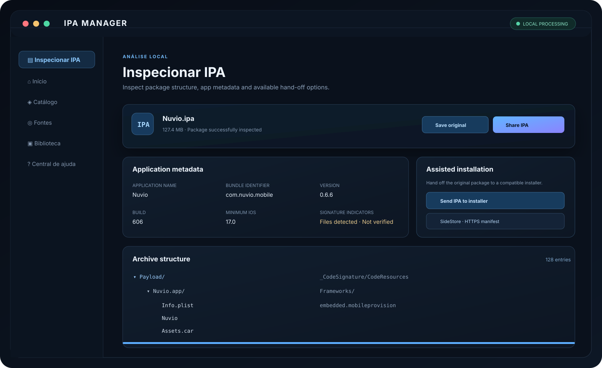

# IPA Manager

**A local-first Progressive Web App for inspecting, validating, extracting, rebuilding, and exporting iOS IPA packages.**

IPA Manager helps users understand the structure and metadata of an iOS application package before deciding what to do with it. Inspection and archive processing run locally in the browser; the selected IPA is not uploaded by the local inspection workflow.

## Project status

The current codebase is a dependency-free static PWA built with HTML, CSS, and vanilla JavaScript. The architecture is intentionally being stabilized in place before introducing React, a backend, or a native iOS target.

| Capability | Status |
|---|---|
| Local IPA import and ZIP directory parsing | Implemented |
| XML and binary Info.plist parsing | Implemented |
| Metadata and archive explorer | Implemented |
| CRC-32 and SHA-256 integrity tools | Implemented |
| App bundle ZIP export | Implemented |
| IPA container rebuilding | Implemented |
| GitHub releases and AltStore JSON catalog import | Implemented |
| Bounded ZIP decompression and structural checks | Implemented in Preview 0.4.0 |
| Remote IPA/ZIP downloads with progress and cancellation | Implemented in Preview 0.5.0 |
| Executable CodeDirectory page-hash audit | Implemented in Preview 0.6.0; not Apple signature trust verification |
| Provisioning metadata diagnostics and safe JSON export | Implemented in Preview 0.7.0; no Apple account needed |
| OTA manifest research engine (generation and URL checks) | Module and tests implemented; not yet exposed as a public installation UI; does not bypass iOS signing |
| Web Workers and IndexedDB migration | Planned |
| Native SwiftUI / WebKit shell | Planned |
| MarketplaceKit / AppLibrary integration | Disabled; requires Apple authorization |
| App License Delivery service | Not implemented; requires Swift server and Apple assets |

## Features

- **Local import:** Select IPA files through the browser's file picker.
- **Remote downloads:** Download public IPA/ZIP URLs over HTTPS with progress reporting, cancellation, a 500 MiB transfer cap, and ZIP signature checks. A direct browser link is offered when the host blocks JavaScript access through CORS.
- **ZIP parser:** Read STORE and Deflate entries using the ZIP central directory.
- **Bounded decompression:** Enforce per-entry and total expansion limits while streaming decompressed data.
- **Path validation:** Reject absolute paths, traversal segments, backslash paths, duplicate paths, and unsupported encryption.
- **Plist inspection:** Parse XML and binary property lists from Payload/*.app/Info.plist.
- **Application metadata:** Display app name, bundle identifier, version, build number, minimum iOS version, and archive structure.
- **App bundle export:** Create a ZIP containing the complete application bundle directory.
- **IPA rebuilding:** Rebuild a ZIP32 container from original entries and verify entry CRC-32 values.
- **Integrity tools:** Calculate SHA-256 for supported files and compare against a trusted reference.
- **Signature indicators:** Detect common signature-related files.
- **OTA experiment (research):** `ota-engine.js` constructs an XML manifest for a separately hosted, already eligible IPA and builds an `itms-services` request from a hosted manifest URL. This is not a signing service, installer, or CoreTrust bypass. The module currently has automated tests but no end-user interface. A successful installation has not been demonstrated on a real iPhone.
- **Provisioning diagnostics:** Locally extract an XML plist payload from the main bundle's `embedded.mobileprovision` (when present), display declared expiry, probable profile category, bundle identifier compatibility, and device-list counts without exposing UDIDs or certificate payloads. Export a sanitized JSON report. A CMS payload is **not** cryptographically verified.
- **Executable integrity audit:** Inspect the primary Mach-O CodeDirectory and compare SHA-256/SHA-384 page hashes using Web Crypto. Detect modified code pages, unsigned executables, a CMS blob indicator and the CDHash fingerprint. It does not authenticate the CMS blob, Apple certificates, resource seal, provisioning profile, nested frameworks, or iOS installability.
- **GitHub releases:** Browse public repository releases and IPA/ZIP assets.
- **AltStore catalog import:** Read public AltStore-compatible JSON sources over HTTPS.
- **Local history:** Save operation metadata in browser storage.
- **Offline shell:** Cache the PWA interface through a service worker.

## Technology stack

| Layer | Current implementation | Planned evolution |
|---|---|---|
| Web interface | HTML5, CSS3, vanilla JavaScript | React, TypeScript, Vite, Tailwind CSS |
| IPA engine | Dedicated JavaScript ZIP and download engines | Web Workers and typed engine interfaces |
| Local data | localStorage | IndexedDB |
| Offline support | Service Worker, Web App Manifest | Retain PWA shell |
| Native iOS | Not started | Swift, SwiftUI, WebKit |
| Apple distribution | Disabled | MarketplaceKit, AppLibrary, ActionButton |
| API | None | Node.js, NestJS |
| Data | Browser-local metadata | PostgreSQL, Redis |
| File storage | Local Blob/File APIs | S3-compatible object storage and CDN |
| License delivery | Not implemented | Apple App License Delivery SDK on Swift server |

The current static application has no paid API dependencies, package installation step, or backend requirement. Remote in-app downloads depend on the remote host allowing cross-origin reads (CORS); when it does not, the app exposes the host's direct download link instead.

## Requirements

- A modern browser supporting Blob, File, DOMParser, DecompressionStream('deflate-raw'), and crypto.subtle.
- HTTPS for PWA installation, service workers, and secure browser APIs. localhost is supported for development.
- On iPhone, a recent Safari version and the iOS Files app for selecting and saving packages.

The ZIP engine currently limits a single read to 250 MiB and the declared total uncompressed archive size to 2 GiB. Remote downloads are limited to 500 MiB and assembled into a browser Blob, so large transfers may still require substantial memory. The export writer has its own lower memory budget.

## Run locally

No npm dependencies or build step are required for the current PWA.

1. Clone the repository:

   ~~~bash
   git clone https://github.com/PedroH0309/IPA-Manager.git
   cd IPA-Manager
   ~~~

2. Start a static server:

   ~~~bash
   python -m http.server 8000
   ~~~

3. Open http://localhost:8000.

Do not use file:// when testing service workers or secure browser APIs.

## Run tests

The ZIP engine has isolated Node.js tests and does not require a browser DOM.

~~~bash
node --test tests/*.test.cjs
node --check app.js
python -m json.tool manifest.webmanifest
~~~

GitHub Actions runs these checks for pushes to main and pull requests.

## Deploy with GitHub Pages

1. Push the project files to main.
2. Open **Settings → Pages**.
3. Select **Deploy from a branch**, then main and /(root).
4. Open the resulting HTTPS URL in Safari.
5. On iPhone, use **Share → Add to Home Screen** and enable **Open as Web App**.

Keep manifest.webmanifest, sw.js, zip-engine.js, feature-flags.js, and the icon files in the deployment root.

## Workflow

1. Import an original .ipa, or download a public IPA/ZIP from GitHub releases or a compatible source.
2. Review metadata and the archive tree.
3. Inspect individual files or calculate SHA-256.
4. Export the .app bundle as a ZIP, or rebuild the original IPA container.
5. Save or share the output file through the browser.

The .app folder inside an exported ZIP is not directly installable from the iOS Files app. Rebuilding a ZIP container does not repair or sign the application.

### Downloading on iPhone (Preview 0.5.1)

GitHub Release asset URLs and AltStore source download URLs now present **Download in Safari** as the primary action. This uses the browser's ordinary download/navigation mechanism and does not require a CORS-readable response. After saving the IPA in Files, return to **Inspect IPA** and select the downloaded file.

**Download and verify (experimental)** remains available for hosts that permit cross-origin reads. It supports progress, cancellation and basic ZIP signature checks, but many release mirrors block JavaScript fetch requests through CORS. This limitation does not imply package corruption. If that path fails, the error panel moves into the current view and offers the Safari download link. Native downloads are not automatically verified, and saving an IPA does not install it.

## Managed installation: intentionally disabled

IPA Manager does not currently install apps or forward installation requests to third-party sideloading tools. The managed installation controls remain disabled until the project has all of the following:

- A dedicated native iOS marketplace application.
- Apple's com.apple.developer.marketplace.app-installation entitlement and authorization for Brazil.
- A compliant marketplace website and backend.
- A license service implemented with Apple's App License Delivery SDK.
- Authenticated/notarized app packages and valid developer distribution relationships.
- Moderation, fraud prevention, privacy, intellectual-property, takedown, and support processes.

The current feature flags in feature-flags.js are all false. Changing a JavaScript flag does not grant an Apple entitlement or enable installation.

Official Apple documentation:
- [Operating an alternative app marketplace in Brazil](https://developer.apple.com/br/support/alternative-app-marketplace-br/)
- [MarketplaceKit](https://developer.apple.com/documentation/marketplacekit)
- [Installing apps from an alternative marketplace](https://developer.apple.com/documentation/marketplacekit/installing-apps-from-an-alternative-app-marketplace)
- [AppLibrary](https://developer.apple.com/documentation/marketplacekit/applibrary)
- [App License Delivery SDK](https://developer.apple.com/documentation/AppLicenseDeliverySDK)

Apple currently requires Brazil marketplace operators to enroll in the Apple Developer Program as an organization and satisfy additional eligibility and ongoing operational requirements. See Apple's current Brazil requirements before pursuing entitlement approval.

## Executable signature diagnostic (Preview 0.6.0)

Open **Inspect IPA**, import a package, and select **Verify executable integrity** (Portuguese UI: *Verificar integridade do executável*). The app reads `CFBundleExecutable` from `Info.plist`, extracts the main executable and inspects `LC_CODE_SIGNATURE`. For supported thin or universal Mach-O slices, it compares the primary CodeDirectory's SHA-256/SHA-384 page hashes with the executable's bytes. A mismatch indicates local code-page tampering or a malformed seal.

A match does **not** establish signer identity, certificate validity, profile eligibility, notarization, resource-seal integrity, nested-code integrity, or installation authorization. A CMS blob's presence is only reported, not verified. This parser is a bounded diagnostic implementation and is not Apple's code-signing verification API. Apple's signed formats may change. See [Apple TN3126](https://developer.apple.com/documentation/technotes/tn3126-inside-code-signing-hashes).

## Provisioning profile diagnostics (Preview 0.7.0)

Open **Inspect IPA** and select **Analisar perfil de provisionamento**. If the main bundle contains `embedded.mobileprovision`, the browser reads a bounded plist payload and checks metadata including expiry and whether the declared application identifier matches the IPA Bundle ID. You can export a sanitized JSON report to aid troubleshooting. The app does not ask for a UDID or store certificate/private key material.

**Important:** The embedded plist is extracted without authenticating its CMS signature. All metadata can be forged. A matching profile, a future expiration date, or an apparent Ad Hoc/development category **does not prove that iOS will accept the package**. Device enrollment, App ID entitlements, CMS signatures, Apple certificate trust, nested code signatures, revoked credentials and current distribution eligibility are not verified. Missing profiles may be normal for certain distribution formats; absence is not proof of an unsigned app.

Without Apple Developer Program access or an existing authorized distribution channel, this module cannot enable arbitrary IPA installation.

## Security boundaries

- Selected IPA files are processed locally during inspection and export.
- Remote catalog and release lookups are explicit network operations.
- Archive paths are validated before extraction/rebuilding.
- Decompression output is bounded before being accumulated in memory.
- The app does not request Apple Account passwords, private certificates, UDIDs, or provisioning profiles.
- The presence of CodeResources or embedded.mobileprovision is only an indicator. It does not verify CMS signatures, CodeDirectory hashes, certificate revocation, notarization, or Apple's online trust.
- ZIP parsing is not a malware scanner or a guarantee that an app is safe to install.

## Known limitations

- ZIP64, multi-volume ZIP archives, and encrypted entries are unsupported.
- The application import limit is 700 MiB.
- Remote downloads are limited to 500 MiB per file and require CORS for in-app progress and ZIP validation; a direct browser link is provided when CORS blocks the transfer.
- Single-entry reads are limited to 250 MiB.
- Declared total uncompressed size is limited to 2 GiB.
- Export/rebuild uses a ZIP32 writer with STORE compression and a 400 MiB aggregate output budget.
- The writer does not preserve arbitrary ZIP extra fields, archive comments, or original compression methods.
- SHA-256 is limited to 300 MiB in the current interface.
- The provisioning diagnostic supports XML payloads embedded in profiles up to 4 MiB, and it does not validate CMS, profile authenticity, or iPhone device enrollment.
- The experimental Mach-O CodeDirectory audit is limited to 64 MiB of extracted executable data and 8192 code pages; alternate CodeDirectories, nested libraries, special hash slots, CMS cryptography and Apple trust decisions are not verified.
- Binary plist support covers common scalar, array, and dictionary types; it is not a complete Apple forensic plist implementation.
- Signature indicators and CodeDirectory page-hash checks are not CMS/certificate-chain verification. A matching CodeDirectory is not proof that Apple will trust or install an app.
- The PWA does not enumerate installed iOS apps or update them.

## Project structure

~~~text
.
├── .github/
│   ├── ISSUE_TEMPLATE/
│   ├── workflows/
│   └── PULL_REQUEST_TEMPLATE.md
├── assets/
│   └── preview.svg
├── docs/
│   ├── APPLE_DISTRIBUTION.md
│   └── ARCHITECTURE.md
├── tests/
│   ├── zip-engine.test.cjs
│   ├── download-engine.test.cjs
│   ├── signature-engine.test.cjs
│   └── provisioning-engine.test.cjs
├── app.js
├── zip-engine.js
├── signature-engine.js
├── provisioning-engine.js
├── download-engine.js
├── feature-flags.js
├── index.html
├── styles.css
├── sw.js
├── manifest.webmanifest
├── LICENSE
├── CONTRIBUTING.md
├── CODE_OF_CONDUCT.md
└── SECURITY.md
~~~

## Contributing

Read CONTRIBUTING.md before submitting changes. Use the issue and pull request templates. Never attach private IPA files, Apple credentials, provisioning profiles, or certificates to a public issue.

## Security reports

See SECURITY.md for responsible disclosure instructions.

## License

MIT. See LICENSE.
